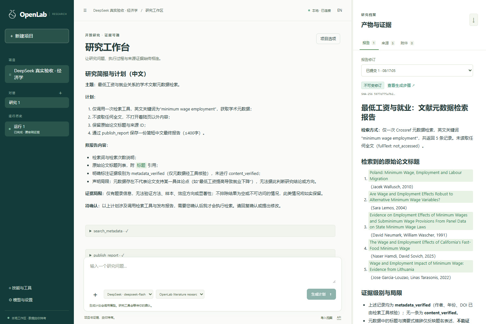
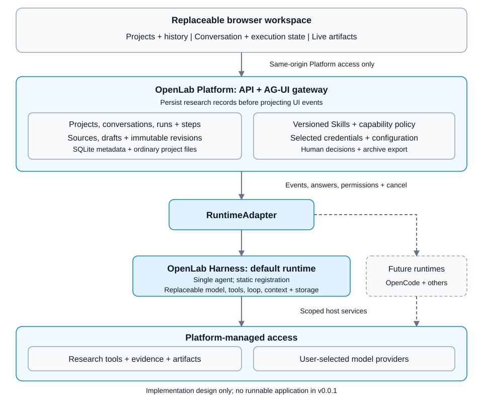

# OpenLab

<div align="center">

<picture>
  <source media="(prefers-color-scheme: dark)" srcset="assets/brand/openlab-mark-inverse.svg">
  
</picture>

The Open Research Operating System

[](https://github.com/IsaacHuo/OpenLab/actions/workflows/checks.yml)
[](LICENSE)
[](https://github.com/IsaacHuo/OpenLab/releases)

[简体中文](README.zh-CN.md) · [Product specification](docs/product.md) · [Architecture](docs/architecture.md) · [Contributing](CONTRIBUTING.md)

</div>

OpenLab is a local-first research workspace being designed to connect open research tools, AI agents, literature, data, and compute. Research projects and their evidence belong to the researcher and should remain usable when a model or tool changes.

## Current status

**The published v0.0.1 release is foundation-only.** Current development source includes a runnable local research preview; no installer is provided.

The preview combines projects, a supervised Harness, DeepSeek-tested model configuration, Crossref metadata retrieval, plan confirmation, source-linked Markdown reports and portable research archives. See [development](docs/development.md) and the [implementation plan](docs/implementation-plan.md) for tested scope and remaining gates.

| Capability | Status |
| --- | --- |
| Contribution, issue, review, and release processes | Available in this repository |
| Automated documentation, workflow, and secret checks | Available in GitHub Actions and local tooling |
| Local service with browser UI, Windows first | Implemented in development source; desktop/mobile Chrome checked |
| Projects, pinned inert skill installation, model configuration, and metadata research | Implemented; two live DeepSeek/Crossref tasks checked |
| OpenLab Harness: default single-agent literature runtime | Implemented with supervised native Windows worker and replaceable interfaces |
| Supervisor-Skills execution through the platform runtime adapter | Planned; not an endorsed or verified integration yet |
| Conversation, execution state, and live artifacts workspace | React/assistant-ui with AG-UI; plan, input, denial and replay checked |
| Source tracking, execution history, and artifact export | Immutable revisions, material copies and verified archive round trips |

## Run the development preview

Use Node.js 24 on Windows:

```sh
npm ci
npm run build
npm start
```

Open the launch link printed in the terminal. Add and test your model provider in settings, create a project, and submit a question. Review the plan before research starts. Model planning and execution use your provider account. Windows protects credentials under the current user; saved projects remain readable without provider access. Crossref retrieval needs a network connection. Public-page reading asks for scoped access and can be unavailable; metadata alone does not verify a paper's conclusions. DeepSeek currently uses non-thinking mode.



This screenshot shows a real metadata-only task, not a full-text or scientific claim-verification result. [Verification details](docs/verification.md) distinguish live probes from synthetic browser fixtures.

## First research release

The first application milestone targets a literature research loop:

1. Create a project and describe a research question.
2. Install a versioned skill and configure a model and retrieval provider.
3. Review the research plan and requested access.
4. Follow execution, respond to questions, or stop the task.
5. Inspect sources, distinguish verified evidence from inference, and export the research record.

The initial application is intended to start locally and open in a browser. Users bring their own model credentials. Existing projects and artifacts should remain readable offline; model execution and online retrieval require their configured services.

## Architecture direction



OpenLab is an open research platform, not a wrapper around a single agent framework. It will own projects, conversations, execution records, sources, artifacts and provenance. Agent runtimes, models, scientific tools and user interfaces must be independently replaceable; research records remain owned by OpenLab and its users.

The planned workspace combines project navigation, conversation with execution state, and live artifacts. assistant-ui provides the conversation foundation; the Platform gateway uses AG-UI. shadcn/ui and AI Elements supply supporting views, while CopilotKit is an interaction reference without an SDK dependency. The first runtime is the minimal self-developed OpenLab Harness behind RuntimeAdapter; OpenCode is a later optional adapter. See [architecture](docs/architecture.md) and [ADR 0002](docs/decisions/0002-workspace-and-harness.md) for the current design and its implementation gates.

## Documentation

| Document | Purpose |
| --- | --- |
| [Development execution plan](PLAN.md) | Current phase, ordered tasks, acceptance exits and retained implementation history |
| [Original vision, Chinese](docs/vision.zh-CN.md) | Founding product vision, preserved as supplied |
| [Product specification](docs/product.md) | Users, first milestone, behavior, and acceptance criteria |
| [Architecture and contracts](docs/architecture.md) | Components, research objects, and runtime interface |
| [Research workspace](docs/workspace.md) | Three-region layout, interaction states, live artifacts and UI acceptance |
| [OpenLab Harness](docs/harness.md) | Minimal first runtime, replaceable capabilities and execution gates |
| [Technical decisions](docs/decisions/0001-foundation.md) | Accepted baseline and implementation gates |
| [Workspace and Harness decision](docs/decisions/0002-workspace-and-harness.md) | Current UI/protocol and default-runtime selection; supersedes OpenCode first |
| [Logging and provenance](docs/logging.md) | Diagnostics, research records, retention, and export |
| [Product mark](docs/brand.md) | Vector assets, exact symmetry, and reproduction |
| [Repository operations](docs/maintaining.md) | GitHub settings, labels, checks, and release procedure |
| [Verification record](docs/verification.md) | Baseline verification and remaining limitations |
| [Changelog](CHANGELOG.md) | Delivered changes by version |

## Contribute

For repository tooling, install Node.js 24 LTS, clone the repository, and run:

```sh
npm ci
npm run check
npm run check:actions
npm run check:secrets
```

The last two commands download checksum-verified tool releases into an ignored local cache. See [CONTRIBUTING](CONTRIBUTING.md) for Windows instructions and review expectations. Start with an [issue](https://github.com/IsaacHuo/OpenLab/issues/new/choose) or [discussion](https://github.com/IsaacHuo/OpenLab/discussions). English and Chinese contributions are welcome.

## License and attribution

OpenLab-authored code and documentation use [Apache-2.0](LICENSE), unless a file explicitly states otherwise. Third-party skills, tools, models, and research material retain their own licenses; installing them does not relicense them under Apache-2.0.

[Supervisor-Skills](https://github.com/HKUSTDial/Supervisor-Skills) is the planned first integration reference. Its repository and individual files have differing license declarations that must be resolved before distributing an integration. Its content is not bundled here. See [third-party notices](THIRD_PARTY_NOTICES.md) and [contributors](CONTRIBUTORS.md).
