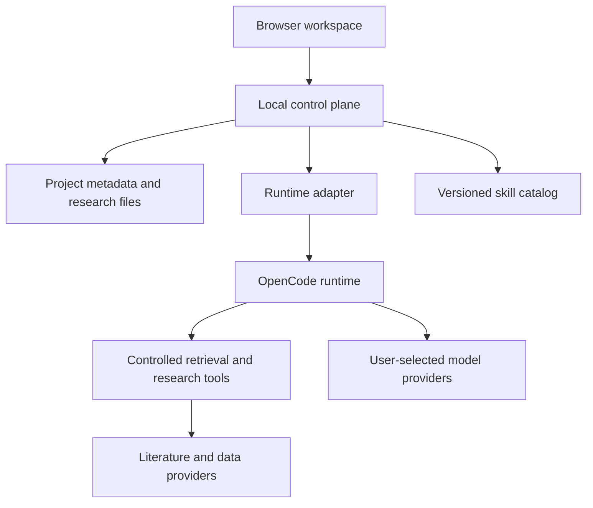

# OpenLab


The Open Research Operating System

[](https://github.com/IsaacHuo/OpenLab/actions/workflows/checks.yml)
[](LICENSE)
[](https://github.com/IsaacHuo/OpenLab/releases)

[简体中文](README.zh-CN.md) · [Product specification](docs/product.md) · [Architecture](docs/architecture.md) · [Contributing](CONTRIBUTING.md)

OpenLab is a local-first research workspace being designed to connect open research tools, AI agents, literature, data, and compute. Research projects and their evidence belong to the researcher and should remain usable when a model or tool changes.

## Current status

**v0.0.1 establishes repository governance and design documents. There is no runnable research application or installer in this release.** The commands below validate this repository; they do not launch OpenLab. Screenshots and research demonstrations will be added when the corresponding functionality is available.

| Capability | Status |
| --- | --- |
| Contribution, issue, review, and release processes | Available in this repository |
| Automated documentation, workflow, and secret checks | Available in GitHub Actions and local tooling |
| Local service with browser UI, Windows first | Planned |
| Projects, skill installation, model configuration, and literature research | Planned |
| Supervisor-Skills execution through OpenCode | Planned; not an endorsed or verified integration yet |
| Source tracking, execution history, and artifact export | Specified; implementation planned |

## First research release

The first application milestone targets a literature research loop:

1. Create a project and describe a research question.
2. Install a versioned skill and configure a model and retrieval provider.
3. Review the research plan and requested access.
4. Follow execution, respond to questions, or stop the task.
5. Inspect sources, distinguish verified evidence from inference, and export the research record.

The initial application is intended to start locally and open in a browser. Users bring their own model credentials. Existing projects and artifacts should remain readable offline; model execution and online retrieval require their configured services.

## Architecture direction



OpenLab will own projects, run records, artifacts, and provenance. A replaceable adapter will connect an existing agent runtime. The [architecture](docs/architecture.md) separates this design from functionality already implemented.

## Documentation

| Document | Purpose |
| --- | --- |
| [Original vision, Chinese](docs/vision.zh-CN.md) | Founding product vision, preserved as supplied |
| [Product specification](docs/product.md) | Users, first milestone, behavior, and acceptance criteria |
| [Architecture and contracts](docs/architecture.md) | Components, research objects, and runtime interface |
| [Technical decisions](docs/decisions/0001-foundation.md) | Accepted baseline and implementation gates |
| [Logging and provenance](docs/logging.md) | Diagnostics, research records, retention, and export |
| [Product mark](docs/brand.md) | Vector assets, exact symmetry, and reproduction |
| [Repository operations](docs/maintaining.md) | GitHub settings, labels, checks, and release procedure |
| [Verification record](docs/verification.md) | Baseline verification and remaining limitations |
| [Changelog](CHANGELOG.md) | Delivered changes by version |

## Contribute

For repository tooling, install Node.js 24 LTS, clone the repository, and run:

```sh
npm ci
npm run check
npm run check:actions
npm run check:secrets
```

The last two commands download checksum-verified tool releases into an ignored local cache. See [CONTRIBUTING](CONTRIBUTING.md) for Windows instructions and review expectations. Start with an [issue](https://github.com/IsaacHuo/OpenLab/issues/new/choose) or [discussion](https://github.com/IsaacHuo/OpenLab/discussions). English and Chinese contributions are welcome.

## License and attribution

OpenLab-authored code and documentation use [Apache-2.0](LICENSE), unless a file explicitly states otherwise. Third-party skills, tools, models, and research material retain their own licenses; installing them does not relicense them under Apache-2.0.

[Supervisor-Skills](https://github.com/HKUSTDial/Supervisor-Skills) is the planned first integration reference. Its repository and individual files have differing license declarations that must be resolved before distributing an integration. Its content is not bundled here. See [third-party notices](THIRD_PARTY_NOTICES.md) and [contributors](CONTRIBUTORS.md).
