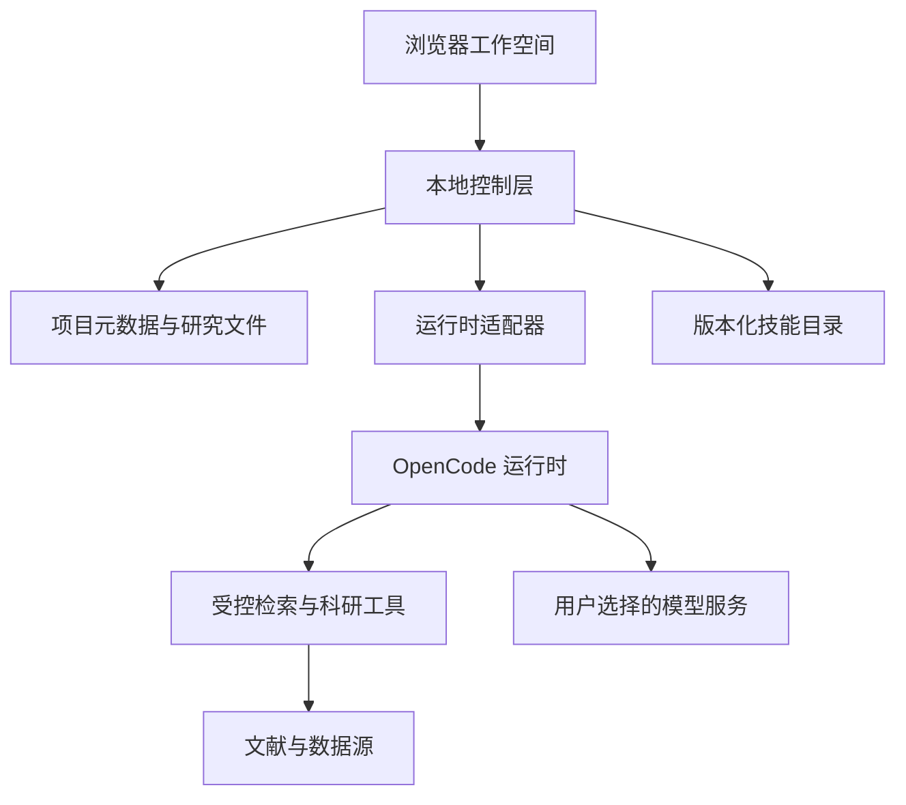

# OpenLab

<picture>
  <source media="(prefers-color-scheme: dark)" srcset="assets/brand/openlab-mark-inverse.svg">
  
</picture>

开放式科研操作系统 · The Open Research Operating System

[](https://github.com/IsaacHuo/OpenLab/actions/workflows/checks.yml)
[](LICENSE)
[](https://github.com/IsaacHuo/OpenLab/releases)

[English](README.md) · [产品规格](docs/product.md) · [架构](docs/architecture.md) · [贡献指南](CONTRIBUTING.zh-CN.md)

OpenLab 致力于建立本地优先的科研工作空间，将已有的开源科研工具、AI Agent、文献、数据和计算能力组织起来。研究项目、成果和证据由研究者持有，并能够在更换模型或工具后继续使用。

## 当前状态

**v0.0.1 交付仓库规范、协作流程和设计文档，目前没有可运行的科研应用或安装包。** 仓库中的 npm 命令用于校验文档和自动化配置。截图与科研演示会在对应能力实际可用后补充。

| 能力 | 状态 |
| --- | --- |
| 贡献指南、Issue/PR 模板与发布流程 | 本仓库提供 |
| 文档、工作流与密钥扫描 | GitHub Actions 与本地工具提供 |
| Windows 优先、本地启动、浏览器交互 | 计划实现 |
| 项目管理、技能安装、模型配置与文献研究 | 计划实现 |
| 通过 OpenCode 执行 Supervisor-Skills | 计划集成，尚未通过执行验证 |
| 来源追踪、运行历史与成果导出 | 已定义规格，待实现 |

## 首个科研版本

1. 创建研究项目，明确研究问题。
2. 安装固定版本的技能，配置模型与检索服务。
3. 审查研究计划和所需权限。
4. 查看执行过程、回答问题，或停止任务。
5. 核对来源与成果，区分已验证证据、模型推断和待检验假设，并导出研究记录。

首版采用本地服务和网页界面，用户自行配置模型凭据。已有项目与成果应可离线查看；模型执行和在线检索需要对应服务可用。

## 架构方向



平台持有项目、运行记录、成果和来源信息，通过可替换的适配器连接 Agent 运行时。实现边界见[架构文档](docs/architecture.md)。

## 文档导航

- [原始产品愿景](docs/vision.zh-CN.md)：保留用户提供的完整规划。
- [产品规格](docs/product.md)：用户、首版流程和验收条件。
- [架构与接口](docs/architecture.md)、[技术决策](docs/decisions/0001-foundation.md)。
- [日志与科研追溯规范](docs/logging.md)。
- [产品标识与矢量文件](docs/brand.md)：精确镜像轮廓、圆弧与中心对称波浪。
- [仓库维护与发布](docs/maintaining.md)、[验证记录](docs/verification.md)、[变更日志](CHANGELOG.md)。

## 参与贡献

仓库维护工具需要 Node.js 24 LTS：

```sh
npm ci
npm run check
npm run check:actions
npm run check:secrets
```

后两项命令会下载校验过 SHA-256 的工具到本地缓存。Windows PowerShell 的操作方式见[中文贡献指南](CONTRIBUTING.zh-CN.md)。可以通过 [Issue](https://github.com/IsaacHuo/OpenLab/issues/new/choose) 报告问题，通过 [Discussions](https://github.com/IsaacHuo/OpenLab/discussions) 交流研究需求；欢迎中英文参与。

## 许可与来源

OpenLab 自有代码与文档采用 [Apache-2.0](LICENSE)，明确标注例外的文件除外。第三方工具、技能、模型和科研资料保留自己的许可。

[Supervisor-Skills](https://github.com/HKUSTDial/Supervisor-Skills) 是计划中的首个集成参考，尚未随本项目分发；其仓库与部分文件存在许可标注差异，集成发布前需要核实。详见[第三方说明](THIRD_PARTY_NOTICES.md)与[贡献者](CONTRIBUTORS.md)。
