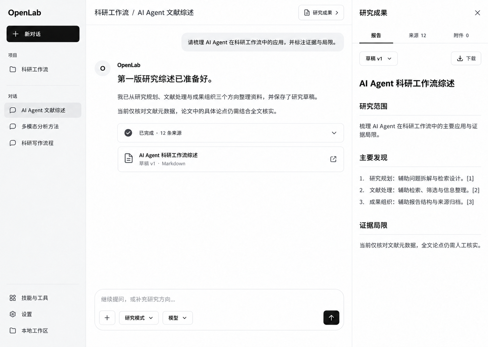

# OpenLab UI 设计规范

状态：已选定的设计目标，2026-10-24。本目录约束当前及后续前端实现；代码与验证记录见[开发验证](../../docs/verification.md)。

## 已确认的设计

采用最后一组四张同页面对比稿中的第一张：浅灰导航、白色聊天与报告区域、黑色主要操作、细分隔线。聊天是主入口，执行过程与研究成果提供辅助。

在第一张基础上，用户确认两项修订：

1. 删除输入框下方整行常驻帮助文案，不保留替代标语、提示或空白占位组件。
2. 输入框圆角更圆润；本规范将外容器圆角落实为 `24px`。按钮、菜单和成果条目继续使用各自的小圆角，不一起放大。

此图为设计示意，不是运行中页面截图。图中的研究内容、12 条来源、草稿 v1 与对话名称是示例数据，不能硬编码进正式 UI。后续截图验收使用相同页面状态、视口和内容进行比较。

## 阅读顺序与适用范围

| 文件 | 用途 |
| --- | --- |
| [视觉系统](DESIGN.md) | 配色、排版、间距、圆角、状态与组件约束 |
| [工作区规范](workspace.md) | 布局、导航、聊天输入、执行记录、研究成果、响应式与验收 |
| [设计令牌](tokens.css) | 上述视觉数值的唯一 CSS 定义，供后续实现复用 |
| [确认后的参考图](reference/approved-desktop.png) | 第一张方案与两项修订的视觉目标 |

本目录是用户指定的新设计文档入口，不迁移或取代现有 `docs/` 中的产品、后端和运行协议说明。[现有工作区规格](../../docs/workspace.md)继续约束功能语义；本目录约束其新版视觉与呈现方式。

执行顺序以用户最新明确要求为先；本目录的明确规则优先于参考图中的细微生成误差。旧前端颜色、其他未选稿和 Skills 的默认审美建议均不能覆盖本规范。

## 产品约束

- 产品身份始终为 OpenLab。DeepSeek 等名称只能作为用户配置的模型信息出现，不用于产品标题、品牌、欢迎语或示例项目身份。
- 正式工作区不使用“真实验收”“测试学科”等测试标签命名项目或对话。项目按研究主题命名；验收说明留在测试与文档中，不作为界面文案。
- 采用黑、白、中性灰的浅色界面；本次不增加主题切换，不实现其他三张稿的样式。
- 优先复用 shadcn/ui 与 AI Elements 的适用组件；保留现有 assistant-ui、AG-UI、API、存储与运行逻辑。
- 按用户批准的第二轮计划提供插件化文档编辑、修订对比、LaTeX 编译与 PDF 预览；多人协作、自动发布和图表仪表盘仍属后续。
- 中英文功能一致；正文可读、键盘可操作、重要成本与权限信息可获取。界面文字不承担装饰作用。

## 参考与修订记录

2026-10-24：用户选择最后一组的第一张，明确删除输入框下方小字并增加输入框圆角。本目录首次建立。

参考图使用内置 imagegen 工具，以已选第一张为输入，仅要求移除输入框下方整句帮助文案、将输入框外圆角增加至约 `24px`，其余内容、位置、状态与配色保持一致。修订图保存在本目录，不依赖工具缓存或 `output/` 中的试稿。

规范整理参考了项目已安装的 frontend-design、ui-ux-pro-max、impeccable、web-design-guidelines，以及 design-system、ui-styling Skills。仅吸收其组件、令牌与可访问性方法；调色建议、流程模板与演示内容不构成新的产品需求。
